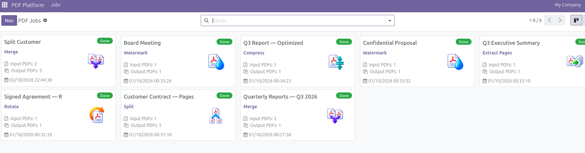
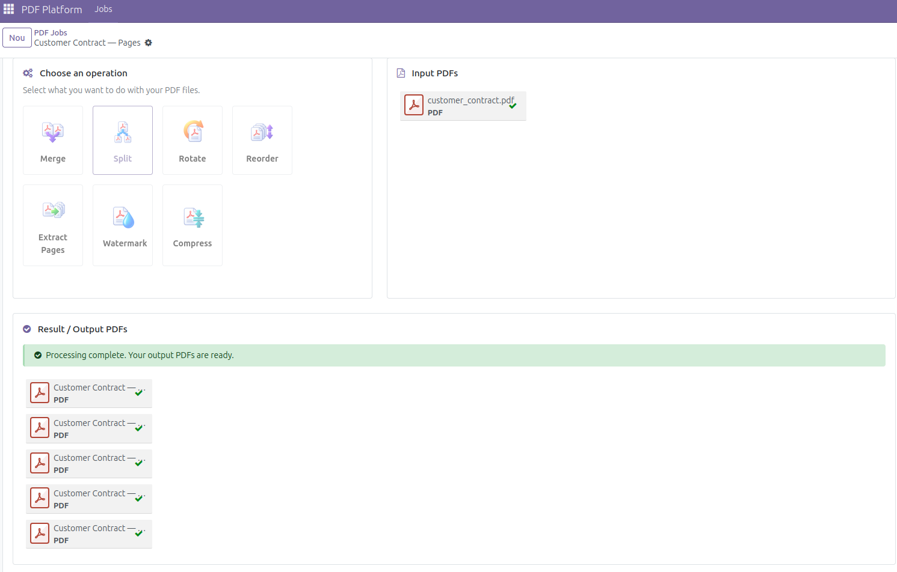
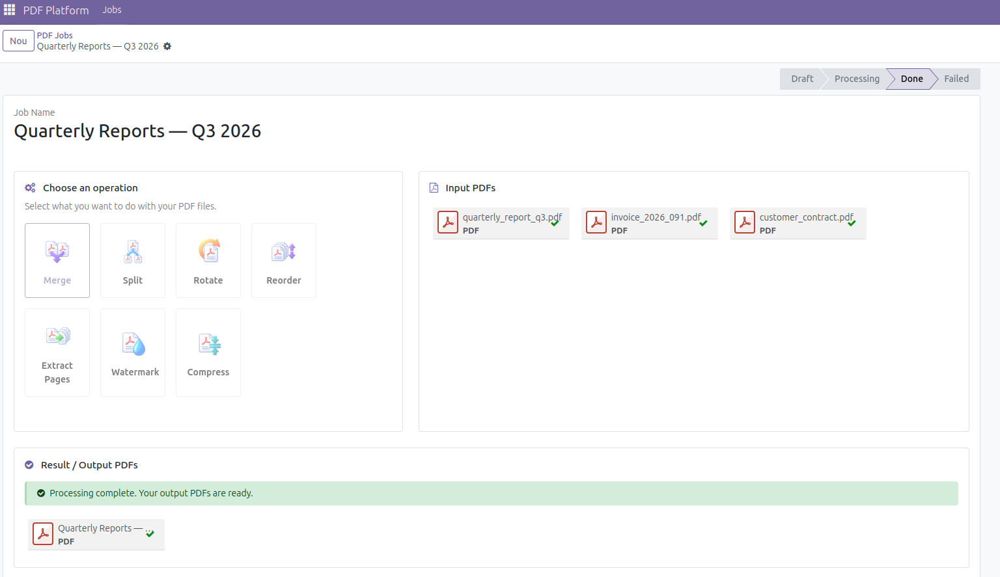

# Odoo PDF Platform

An Odoo 18 application for processing PDF documents through a single job workflow.
Upload files, choose an operation, and download the results from the job form.
The project combines an Odoo addon with a standalone Python PDF engine.

## Features

| Operation | Input | Result |
| --- | --- | --- |
| Merge | 2–10 PDFs | One document with the input pages in the order supplied to the engine |
| Split | One PDF | One separate PDF for each page |
| Extract Pages | One PDF and a selection such as `1,3,5-8` | Selected pages in the requested order; repeated pages are allowed |
| Reorder | One PDF and an order such as `3,1,2` | All pages, each included exactly once, in the requested order |
| Rotate | One PDF and an angle of 90°, 180°, or 270° | All pages rotated by the selected angle |
| Watermark | One PDF and text | A centered, diagonal, semi-transparent text watermark |
| Compress | One PDF and a low, medium, or high compression level | A document rewritten with Ghostscript |

The interface includes a visual operation selector, multiple-file upload,
drag-and-drop, input and output attachment cards, and job states. Failed jobs
show an error and can be corrected using **Fix and Retry**.

## Screenshots

### Dashboard

The jobs dashboard provides an overview of PDF processing tasks and their status.



### Split

Split a PDF into separate documents, with one output PDF for each page.



### Merge

Combine multiple PDFs into a single document and download the merged result.



## Video Demo

**[▶ Watch the Video Demo](https://youtu.be/CgXBFiN-cog)**

The video demonstrates the Merge and Split operations and the resulting PDF
documents. Click the screenshot preview below to watch the demo on YouTube.

[](https://youtu.be/CgXBFiN-cog)

## Technology

- **Odoo 18**: ORM, authentication, access rules, attachments, views, and OWL components.
- **Python**: the addon and independent PDF processing engine.
- **PostgreSQL 15**: application data.
- **Docker and Docker Compose**: local application and database services.
- **pypdf, ReportLab, and Ghostscript**: PDF manipulation, watermark generation, and compression.
- **unittest, Odoo TransactionCase/HttpCase, and HOOT**: engine, integration, and interface tests.

## Project structure

```text
addons/document_pdf_tools/    Odoo addon, views, access rules, and integration tests
pdf_engine/                  Standalone PDF operations and validation
tests/                       Engine tests with generated PDF fixtures
docs/                        Resource policy and reexecution review
Dockerfile                   Odoo image with PDF processing dependencies
docker-compose.yml           Application, PostgreSQL, and persistent volumes
.env.example                 Blank configuration template; no passwords
```

## Installation and configuration

### Requirements

- Docker Engine or Docker Desktop with Docker Compose.
- A free local port `8072`.
- Internet access for the initial image build.

### New installation

Clone the repository and open its directory. Create `.env` from the example
only if a local configuration does not already exist:

```bash
if [ ! -f .env ]; then cp .env.example .env; fi
chmod 600 .env
```

Edit `.env` locally and fill in all three variables:

| Variable | Purpose |
| --- | --- |
| `POSTGRES_USER` | PostgreSQL role used by the application |
| `POSTGRES_PASSWORD` | Password for that role |
| `ODOO_MASTER_PASSWORD` | Odoo database-management password |

The example intentionally leaves both passwords blank. Choose strong, distinct
passwords using a password manager. The master password is separate from the
PostgreSQL password and from an Odoo web user's login password. Never commit `.env`.

Validate the configuration without printing resolved credentials, then start:

```bash
docker compose config --quiet
docker compose up -d --build
```

Open [http://127.0.0.1:8072](http://127.0.0.1:8072). Create a database named
`pdf_platform`, using `ODOO_MASTER_PASSWORD` when the database manager requests
the master password. Choose separate administrator login credentials. Demo data
is optional and is not required by this addon.

In **Apps**, locate **Document PDF Tools** and install it. If necessary, enable
developer mode and update the Apps list. Open **PDF Platform → Jobs**.

### Existing installations

Keep the existing `.env` and its PostgreSQL credentials. Changing
`POSTGRES_PASSWORD` does not change the password stored in an initialized
PostgreSQL volume and may prevent Odoo from connecting. Back up the database
and Odoo filestore before recreating containers or changing deployment settings.

The database and filestore use named Docker volumes. Normal container recreation
preserves them. To stop and start the services without removing containers:

```bash
docker compose stop
docker compose start
```

Both services use `restart: unless-stopped`. Never remove persistent volumes
unless you deliberately intend to delete the application data.

## Usage

1. Create a job under **PDF Platform → Jobs** and give it a name.
2. Choose an operation and fill in its required parameters.
3. Upload the input PDFs. Merge requires at least two files; other operations require one.
4. Click **Process PDF**.
5. When the job reaches `done`, download the output attachments.
6. If it reaches `failed`, read the error, click **Fix and Retry**, correct the input, and process again.

Pages are numbered from **1**. For a four-page document, `1,3-4` extracts pages
1, 3, and 4, while `4,1-3` reorders the entire document. Ranges are ascending
and inclusive. Empty components, inverted ranges, malformed values, and pages
outside the document are rejected before range expansion.

Only `draft` jobs can be processed. Processing a completed job again is rejected.
Processing is synchronous; the `processing` state does not represent a background queue.

## Security

- **V1 — access control:** ordinary internal users can access their own jobs;
  system administrators can access all jobs. Linked attachment searches and
  downloads enforce job access, including public-flag and token download paths.
- **V2 — page selection:** the entire selection is validated before any range is
  expanded, preventing expressions such as `1-1000000000` from allocating enormous lists.
- **V3 — resource admission limits:** shared checks protect both the engine and Odoo.
  Odoo checks attachment metadata before reading binary data and checks actual
  bytes again. Merge validates inputs sequentially before building its output.
- Job processing uses database savepoints. Failed processing rolls back partial
  job changes and attachment records, then records `failed` and a safe error message.
  Unexpected error details remain server-side. Ghostscript diagnostics are not
  returned directly to users.
- Compression uses temporary directories with cleanup on normal failures,
  including timeouts and invalid output.
- Odoo's HTTP port is bound to `127.0.0.1:8072`; PostgreSQL is not published to the host.
  The application runs as the image's `odoo` user. Its master password is loaded
  into a private runtime configuration file rather than passed on the command line.

| Resource | Inclusive limit |
| --- | ---: |
| Each input PDF | 25 MiB (26,214,400 bytes) |
| Pages in each input PDF | 300 |
| Input PDFs per operation | 10 |
| Total input pages per operation | 1,000 |
| Expanded page selection, including repetitions | 1,000 |

Limits are centralized in [`pdf_engine/limits.py`](pdf_engine/limits.py).
Merge outputs can contain up to 1,000 pages; the 300-page limit applies to inputs.
See [`docs/resource_limits.md`](docs/resource_limits.md) for implementation details.

### Public repository precautions

Publish only the reviewed current files into a **new repository with a fresh
history**. Do not push this working repository's existing branches, tags, or
`.git` directory: its old history contains a PostgreSQL password that remains
active. `.gitignore` does not remove secrets from existing commits.

`.env`, local environment variants, database backups/exports, editor swap files,
private keys, and PDFs are excluded from Git. `.env.example` is the only intended
environment template. Exclusion rules do not untrack files already committed;
always inspect the files selected for publication. Test passwords and download
tokens are synthetic fixtures, not deployment credentials.

A fresh history avoids publishing the old secret but does not revoke any earlier
exposure. Credential rotation, if needed, requires a separate authorized change.

## Known limitations

- Admission limits are not hard memory or CPU ceilings. Small PDFs can contain
  expensive images, compressed streams, or malformed object trees. Other than
  Ghostscript's 60-second timeout, the engine has no execution deadline.
- Processing and output generation still use memory. There are no per-user quotas,
  concurrency controls, upload/storage quotas, or general output-size limits.
- The draft-state check does not provide explicit locking across simultaneous
  requests. Concurrent execution needs separate verification and review.
- Abrupt worker termination may leave temporary directories. Rolled-back attachment
  files rely on Odoo's filestore garbage collector.
- PDF validation checks readability and page structure, not every content stream
  or visual fidelity. PDFs needing a non-empty password are rejected.
- The interface does not provide explicit input-file ordering for Merge.
  Watermark styling is fixed; compression does not guarantee a smaller file.
- Dependency versions and image digests are not fully pinned. There is no CI setup.
- This Compose setup is for local use. It does not configure HTTPS, automated
  backups, or production worker isolation. Docker administrators can inspect
  container environment values; `.env` is not a secret-management service.

See [`docs/reexecution_review.md`](docs/reexecution_review.md) for the pending
concurrency and cleanup lifecycle cases.

## Tests

Engine fixtures are generated in memory. Run the standalone suite with:

```bash
docker compose run --rm --no-deps   -v "$PWD:/workspace:ro" -w /workspace   --entrypoint python3 odoo -B -m unittest discover -s tests -v
```

Run Odoo integration tests in a **dedicated test database**, never the working
`pdf_platform` database. With the database service running:

```bash
docker compose run --rm odoo odoo   -d pdf_platform_test -i document_pdf_tools   --without-demo=all --test-enable --test-tags /document_pdf_tools   --stop-after-init --no-http --http-port=8099
```

Use `-u document_pdf_tools` instead of `-i` when updating an existing test database.
Tests cover access control, attachment downloads, safe page ranges, resource
boundaries, rollback, retry, duplicate-call rejection, and compression cleanup.

JavaScript tests are in `addons/document_pdf_tools/static/tests/`. Use Odoo's
HOOT runner at `/web/tests` on a dedicated test instance and filter for
`document_pdf_tools`. The automated browser runner was skipped in the inspected
image because `websocket-client` was missing; that suite is not reported as passed.

The latest engine run passed 62 tests. The targeted reexecution review passed
12 Odoo transaction tests and 15 compression/cleanup tests. These are recorded
results from the local environment, not a fresh build or CI certification.

## License

The Odoo addon manifest declares **LGPL-3**. A standalone license file has not
yet been added to this repository.
